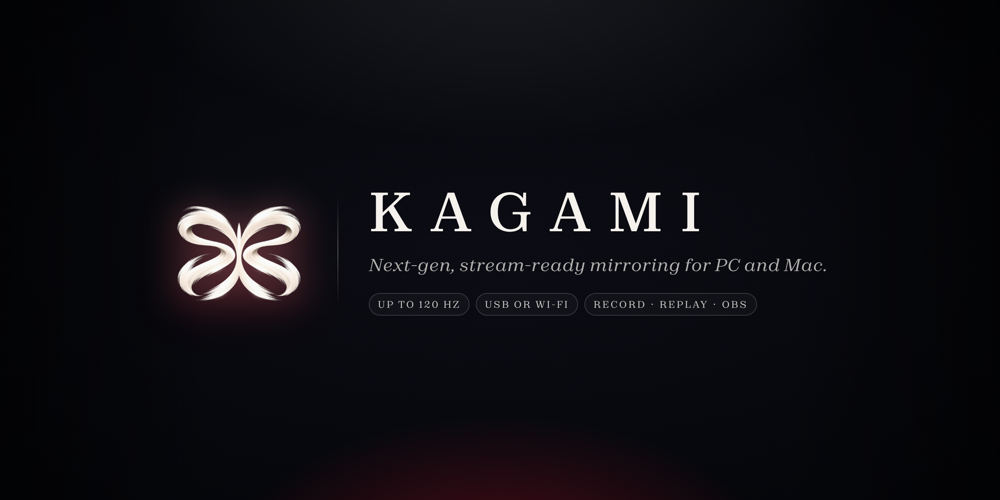

  

  
  
  

  <b><a href="https://kagami.video">Website</a></b> ·
  <b><a href="https://kagami.video/download/">Download</a></b> ·
  <b><a href="https://kagami.video/docs/">Setup guide</a></b> ·
  <b><a href="https://kagami.video/changelog/">Changelog</a></b> ·
  <b><a href="https://kagami.video/vs/">Compare</a></b> ·
  <b><a href="https://www.youtube.com/@kagamiapp">YouTube</a></b>

 

> **Kagami** (鏡, *mirror* in Japanese) puts your phone on your Windows PC or Mac exactly as it looks in your hand: full resolution, up to 120 Hz, with very low delay, over a USB cable or Wi-Fi. Record in one click, keep a replay of the moment you just played, clean up your mic and feed OBS a full-quality picture, all from one app. Nothing to install on the phone.

 

## Why Kagami

<table>
<tr>
<td width="50%" valign="top">

### 🎯 Picture that keeps up
Your device's own full resolution, nothing scaled down, **up to 120 Hz** on ProMotion iPhones and iPads. About **15 ms** average delay on Wi-Fi (measured 0–40 ms), steadier still over a cable. If your network ever slows down, **one click on Fix** catches the picture up.

</td>
<td width="50%" valign="top">

### 🔌 Cable or Wi-Fi
Plug in a USB cable and the picture opens, with nothing to find on the network. Or pick Kagami in **Screen Mirroring** on the same Wi-Fi, like an Apple TV. Both work on every plan.

</td>
</tr>
<tr>
<td valign="top">

### ⏺️ Recording that can't be lost
One-click recording, **protected every 2 seconds inside the app**: even after a crash or a power cut you always get **one complete file**. Game sound and mic **mixed into one video or with your mic as a separate file**, your choice.

</td>
<td valign="top">

### ⏪ Instant replay
Missed the clutch? Save what just happened, after it happened. No recording running all day.

</td>
</tr>
<tr>
<td valign="top">

### 🎙️ Studio-quality mic clean-up
A clean, clear voice built in. No plugins, no extra apps.

</td>
<td valign="top">

### 🎥 Made for OBS
A full-quality feed for OBS even when the Kagami window is small or hidden, plus a clean view with no buttons.

</td>
</tr>
<tr>
<td valign="top">

### 🙈 Privacy mode
One keyboard shortcut covers your screen for viewers, OBS, recordings and replays while you type a password or open a private chat.

</td>
<td valign="top">

### 💻 Same on Windows and Mac
Every feature works the same on Windows 10/11 and on Macs with Apple silicon. Light on your computer, so your game, stream and OBS keep their power.

</td>
</tr>
</table>

## Get started in three steps

1. **[Download Kagami](https://kagami.video/download/)** for Windows or Mac.
2. **Connect:** plug in your iPhone or iPad, or join the same Wi-Fi and pick **Kagami** in Screen Mirroring.
3. **Play:** record, replay, stream. The **[setup guide](https://kagami.video/docs/)** covers recording, replay, the mic and OBS.

## Requirements

| | |
|---|---|
| **Windows** | Windows 10 or 11, 64-bit |
| **Mac** | Apple silicon, macOS 26 or later |
| **Phone** | iPhone or iPad (Android is coming a few months after launch) |
| **Connection** | USB cable, or the same Wi-Fi (5 or 6 GHz is best) |

## Plans

| | Free | Zenn |
|---|---|---|
| Mirroring, USB and Wi-Fi, up to 120 Hz | ✓ | ✓ |
| Crash-safe recording, mic clean-up, OBS feed, privacy mode | ✓ | ✓ |
| Recording length | 2 minutes | Unlimited |
| Kagami watermark on the live window and OBS (never in your files) | Yes | No |
| Instant replay | — | ✓ |
| How you pay | Free | **One payment for a full year. Never renews by itself.** |

Prices for your region: **[kagami.video/pricing](https://kagami.video/pricing/)**. Payments go through trusted payment partners; Kagami never sees or stores your card, UPI or bank details.

## How Kagami compares

Kagami is built for people who **stream, record and play live** from their phone. Honest, sourced comparisons with other mirroring apps, built-in tools and capture cards: **[kagami.video/vs](https://kagami.video/vs/)**.

## Roadmap

- [x] iPhone and iPad on Windows and Mac, over USB or Wi-Fi
- [x] Crash-safe recording, instant replay, studio-quality mic clean-up, OBS feed, privacy mode
- [ ] Android phones (a few months after launch)
- [ ] OBS virtual webcam

Have an idea? **[Open a feature request](../../issues/new/choose)**.

## FAQ

<b>Do I need to install anything on my iPhone?</b>

 No. Kagami uses the iPhone's own Screen Mirroring, or a USB cable. You only install Kagami on your computer.

<b>Is Kagami a subscription?</b>

 No. Zenn is a one-time payment for a full year. It never charges you again by itself; when the year ends, Kagami goes back to Free and you buy again only if you want to.

<b>Is it safe?</b>

 Mirroring, recording and mic clean-up run on your computer; your screen and recordings never reach our servers. Releases are scanned on public malware scanners.

<b>Why is there no source code here?</b>

 Kagami is closed-source. This repository is its public home for announcements, bug reports and feature requests.

## Help and feedback

- 🐞 **Bug or feature request:** [open an issue](../../issues/new/choose)
- 💬 **Questions and setups:** [r/KagamiApp](https://www.reddit.com/r/KagamiApp/) · [Kagami community](https://kagami.video/community/)
- ✉️ **Email:** support@kagami.video

## Follow Kagami

[Website](https://kagami.video) · [YouTube](https://www.youtube.com/@kagamiapp) · [X](https://x.com/ikagamizen) · [Instagram](https://www.instagram.com/ikagamizenn/) · [LinkedIn](https://www.linkedin.com/company/ikagami/) · [Reddit](https://www.reddit.com/r/KagamiApp/)

 

Kagami is proprietary software made by Jod. This repository does not contain the app's source code. iPhone, iPad, Mac, macOS and Apple TV are trademarks of Apple Inc. Windows is a trademark of Microsoft Corporation. OBS is a trademark of the OBS Project.
